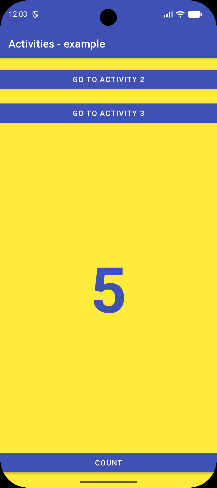
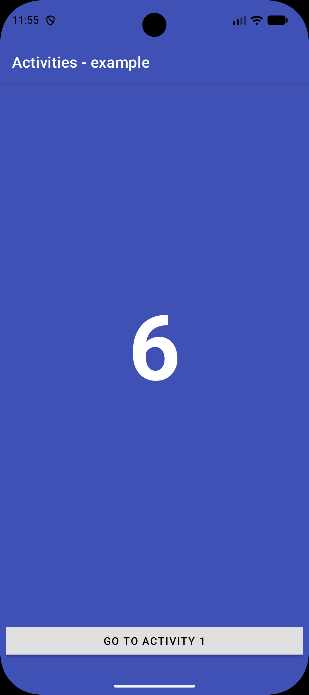
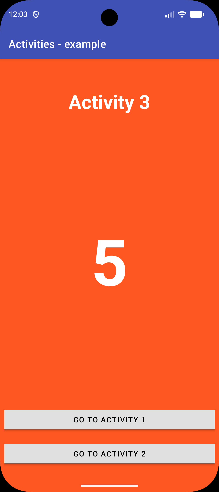

# Activities

Aplikacija s tremi aktivnostmi, ki si z eksplicitnimi nameni podajajo vrednost števca, v Android Studiu.

## Funkcionalnosti

- **MaterialToolbar** z modrim ozadjem in belim naslovom »Activities - example« na vseh treh zaslonih
- **MainActivity** z rumenim ozadjem in števcem v sredini zaslona
  - **Button** »Count«, ki poveča števec za 1; vrednost se ohrani tudi ob obratu zaslona
  - **Button** »Go to activity 2« in »Go to activity 3«, ki zaženeta drugo oziroma tretjo aktivnost in jima z `putExtra()` predata trenutno vrednost števca
- **HelloActivity** z modrim ozadjem, napisom »Hello!« in vrednostjo števca, prebrano z `getIntExtra()`
  - **Button** »Go to activity 1« za vrnitev na prvo aktivnost
- **ThirdActivity** z oranžnim ozadjem, napisom »Activity 3« in vrednostjo števca
  - **Button** »Go to activity 1« in »Go to activity 2« za prehod na prvo ali drugo aktivnost
  - **Potezna navigacija** z razredom `OnSwipeTouchListener`: poteg v levo odpre prvo, poteg v desno pa drugo aktivnost
- Vrnitev na prvo aktivnost uporablja zastavici `FLAG_ACTIVITY_CLEAR_TOP` in `FLAG_ACTIVITY_SINGLE_TOP`, zato se ne ustvarjajo novi primerki in se števec ne ponastavi
- Vsa besedila so v datoteki `strings.xml`

## Posnetki zaslona

  
  &nbsp;&nbsp;&nbsp;
  
  &nbsp;&nbsp;&nbsp;
  

